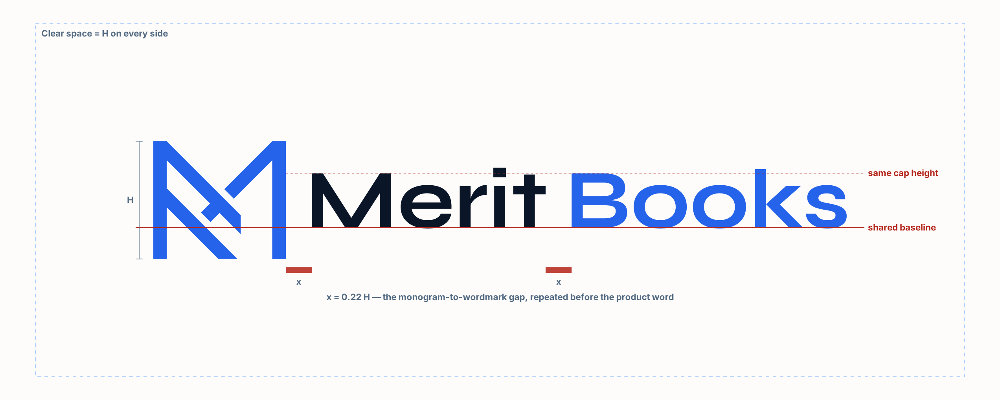

# Merit Enterprise Suite — Product Style Guide

**Version:** v2.3 · October 20, 2026 (v2.3 adds §1.3 Product lockups)
**Applies to:** every Merit Enterprise Suite module — MeritBooks, Projects / ERP, and every module after them.
**Source of truth:** this file + `design-studio/v2/system.css` (the exact tokens and components). If this file and
`system.css` ever disagree on a value, `system.css` wins.
**Binding brand input:** Merit Management Group Brand Guidelines 2026 (pages in `design-studio/assets/`).

> **Repo copy.** This is the MeritBooks-repo copy of the suite guide; paths below point into this repo
> (`design-studio/v2/` = the kit's `reference/`, `design-studio/brand/` = the kit's `logos/` + `tools/`).
> The same guide ships to other suite projects as the "Merit Suite Style Kit" folder.

---

## 0. Read this first (status and one decision already made)

1. **This is the suite standard.** MeritBooks' design work produced one visual system with two densities.
   Every module uses the same tokens, the same shell, the same components. A user moving from Books to
   Projects should not be able to tell where one ends and the other begins, except by the product lockup in
   the rail ("Merit Books" vs "Merit Projects", §1.3).
2. **The old emerald theme is retired.** Earlier MeritBooks builds used emerald `#10b981` on near-black with
   Plus Jakarta Sans and JetBrains Mono. That is **superseded** by this guide (the Merit brand). Do not copy
   colors, fonts, radii or components from the live MeritBooks app at `meritbooks-web.vercel.app` — the live
   app has **not yet been ported** to this system and still shows the emerald theme. Build to this guide, not
   to the live app.
3. **Owner-approved.** The owner approved two visual directions — **A "Annual Report"** and **B "Operator
   Cockpit"** — and they are unified here as two densities of one system. The owner explicitly rejected:
   anything that doesn't follow the Merit brand guidelines; anything that "looks like what basic AI would do";
   a big blue banner with large text at the top of a dashboard.
4. **The bar:** indistinguishable from the best product studios (Linear, Stripe Dashboard, Mercury, Ramp,
   Vercel, Attio). If a screen could pass for a generic AI-generated SaaS dashboard, it fails.

---

## 1. Brand foundations

### 1.1 Logo
- The Merit logo has three official forms: **horizontal** (monogram + "Merit"), **vertical** (monogram over
  "Merit") and the **icon** (monogram alone). Official masters: `design-studio/assets/` (PNG) and Merit Management
  Dropbox → `3-Marketing Department/2026 Branding/Logo/` (PDF masters for print).
- **Inside any suite product, the logo is always the product lockup (§1.3)** — "Merit Books", "Merit Projects",
  "Merit CRM", "Merit FP&A" — never the bare logo with the product name as a separate word or label.
- Never redraw, recolor, stretch, rotate, outline, add shadows/glows, or place on a low-contrast background
  (the guide's "Poor Logo Variations" page, `design-studio/assets/guide-10.png`).
- The monogram's **45° diagonal stroke** is the system's graphic signature (see §7.5 "slash meter" and the
  `//` separator). Use it as a motif; never as decoration for its own sake.

### 1.2 Voice
Confident, direct, operator language. Verbs on buttons. Name things by what the user controls. Let the
numbers persuade.
- **Banned in UI copy:** synergy, leverage, best in class, world-class, revolutionize, solutions.
- **Suite vocabulary:** *client / company*, *workspace*, *consolidation group*, *own books*. Do **not** use
  "portfolio", "portco", "holding company", or "entities" (to mean a company's books) in the UI. Merit
  Management is a tenant; its companies are clients of that tenant.
- The toast repeats the verb: button "Approve 3" → toast "Approved 3".
- Errors explain what happened and what to do. Never apologize, never go vague. Never "No data".
- Honest status: never show a capability as live that isn't. AI-down states say so plainly.

### 1.3 Product lockups — tying the product name into the logo

Every suite module is named **Merit + one product word**: Merit Books, Merit Projects, Merit CRM, Merit FP&A,
Merit Inventory, Merit Payroll, Merit HR, Merit Platform (the admin console). The product word is part of the
logo, built by one rule so every module's lockup matches.



**Construction** (H = monogram height):
1. **Start from the official horizontal logo**, untouched: monogram, gap, "Merit".
2. **Add the product word to the right of "Merit"**, set in **Syne Bold** — the wordmark's own typeface — at the
   **same size, same tracking and the same baseline** as "Merit". Same cap height; nothing smaller, bolder,
   lighter, uppercase or tracked-out.
3. **Spacing:** the gap between "Merit" and the product word equals the gap between the monogram and "Merit"
   (**x = 0.22 H**). One rhythm: monogram · x · Merit · x · Product.
4. **Color:** the product word takes the **brand blue for its background** — **Electric Blue `#2563EB` on light**,
   **Signal Blue `#3B82F6` on Midnight** (Signal is the brand's accent-on-dark; it keeps the word AA-legible at
   rail size). "Merit" keeps its official color (Midnight on light, Warm White on dark). The monogram stays
   Electric Blue in both. In one-color versions (white, Midnight) everything is the one color.
5. **No dividers, slashes, pipes, dots, boxes or tags** between "Merit" and the product word.
6. **Product words:** one word, named as the module is (acronyms stay caps: CRM, HR, FP&A), ≤ 10 characters.
   A new module gets its lockup from the builder (below) — never assembled by hand.

**Forms**
| Form | Use |
|---|---|
| Horizontal lockup | Default everywhere: app rail, sign-in, emails, invoices/statements, decks, website headers |
| Vertical lockup (monogram centered over one line "Merit Books") | Square or tall spaces: sign-in cards, cover pages, social avatars with room |
| Icon (monogram alone) | Favicon, app icon, collapsed rail, phone top bar, anything under 20px tall. Shared by every module; the browser tab title names the module ("To review · Merit Books") |

**Variants** (file suffix → background): `full-color` → Warm White/white · `on-dark` → Midnight ·
`white` → Electric Blue fills or photography · `midnight` → one-color print.

**Sizing & space**
- Clear space = H on every side.
- Minimum: lockup **20px tall** on screen (24px preferred), 0.4 in in print. Below that, use the icon.
- **App rail:** horizontal `on-dark` lockup at **24px tall**, left-aligned in the 48px logo row. Every standard
  module fits the 232px rail at 24px (widest, Inventory: 172px).
- **Written name** in UI copy and documents: **two words — "Merit Books", "Merit Projects"** — matching the
  lockup. One-word forms (meritbooks.app, `meritbooks-web`) are only for URLs and code identifiers.

**Files and the builder**
- Ready-made SVG + PNG for every standard module, form and variant: `design-studio/brand/lockups/`
  (`merit-<module>-<horizontal|vertical>-<variant>.svg|png`; FP&A's slug is `fpa`). Preview: `design-studio/brand/lockup-sheet.png`.
- **Use the files — never typeset a lockup with live HTML text** (kerning and baseline drift between browsers).
  In code: ``.
- New module: `python3 design-studio/brand/build_lockups.py "Field Service"` (needs `pip install fonttools uharfbuzz cairosvg`).
  It builds every form and variant from the Merit monogram's vector paths and the Syne font in `design-studio/brand/fonts/`.
  Its rebuild of the plain Merit logo matches the official 2026 file to within 5 pixels of 47,880.

---

## 2. Color

**Brand hexes are exact. Nothing outside this palette enters a screen.**

### 2.1 Core palette (from the Merit Brand Guidelines 2026)
| Token | Hex | Use | Contrast |
|---|---|---|---|
| `--electric` | `#2563EB` | **The main color.** Page titles, rules, primary buttons, links, focus ring, active states | 5.2:1 on white |
| `--signal` | `#3B82F6` | Accent **on Midnight only** — active nav bar, focus on dark | 4.9:1 on Midnight |
| `--midnight` | `#0A1628` | App shell (rail + top bar), body copy (`--ink`), total rules | 17.7:1 on Warm |
| `--steel` | `#3D4F65` | Secondary text (`--ink-2`); consolidated-view bar | 8.2:1 |
| `--slate` | `#8494A7` | Labels **on Midnight only** (3.1:1 on white — never text on light) | 5.9:1 on Midnight |
| `--warm` | `#FDFCFA` | Page background (Warm White) | |
| `--canvas` | `#F5F3EF` | Insets, notes column, queue group rows, dialog footers | |
| `--sky` | `#EBF2FE` | Selection, AI, info wash | |
| `--white` | `#FFFFFF` | Surfaces that sit on the page (widgets, panels, inputs) | |

### 2.2 Text roles
| Token | Hex | Use |
|---|---|---|
| `--ink` | `#0A1628` | Primary text (17.7:1) |
| `--ink-2` | `#3D4F65` | Secondary text (8.2:1) |
| `--ink-3` | `#536A82` | Captions — **the AA floor for text on light** (5.5:1; 5.0:1 on Canvas/Sky) |
| `--line` | `#E1E5EA` | Hairline |
| `--line-2` | `#CCD3DB` | Control borders |

### 2.3 Tint ramps (sampled from the guide's Usage page, p.14 — use only these)
- Blue: `--blue-300 #6AA8FF` · `--blue-200 #A9CCFF` · `--blue-100 #DCEBFF`
- Grey: `--grey-100 #F2F3F5` · `--grey-200 #E1E5EA` · `--grey-300 #CCD3DB` · `--grey-400 #B5BEC8`
- Night: `--night-800 #1A2A3F` · `--night-700 #2A3E57` · `--night-600 #3F566F` · `--night-500 #5A738D`

### 2.4 Status colors (tuned to sit inside the palette — status only, never decoration)
| Token | Hex | Wash | Meaning |
|---|---|---|---|
| `--pos` (spruce) | `#1F6E50` | `#E6F1EC` | Ready, healthy, favorable |
| `--neg` (brick) | `#B42318` | `#FBEAE8` | Overdue, blocked, error, unfavorable |
| `--warn` (ochre) | `#8A5A00` | `#F7EFDF` | At risk, needs review, low confidence |

### 2.5 Color rules
- **Light theme is the app.** Warm White page, white surfaces, Midnight shell (rail + bar). No dark-mode app.
- **Electric Blue is the only call-to-action color.** Green is never a call to action.
- **Amounts are not colored by debit/credit.** Negatives use parentheses, not red.
- **Status is never color alone** — always a pip shape + a word (§7.4).
- **No gradients, glows, glassmorphism, "AI shimmer", rainbow charts, or emoji.**

---

## 3. Typography

**Syne 700 and DM Sans 400/500/600/700. Nothing else.** No monospace font — figures use DM Sans tabular.

```html
<link rel="preconnect" href="https://fonts.googleapis.com">
<link rel="preconnect" href="https://fonts.gstatic.com" crossorigin>
<link href="https://fonts.googleapis.com/css2?family=DM+Sans:opsz,wght@9..40,400;9..40,500;9..40,600;9..40,700&family=Syne:wght@700&display=swap" rel="stylesheet">
```

| Class | Spec | Use |
|---|---|---|
| `.t-display` | Syne 700 40/48, −0.02em, Electric | A statement's bottom line — once per screen |
| `.t-title` | Syne 700 28/32, −0.01em, Electric | Page title |
| `.t-section` | Syne 700 20/28, Electric | Report-density section/widget titles; dialog titles (in Midnight) |
| `.t-head` | DM Sans 600 15/24, Ink | Cockpit widget titles, note claims |
| `.t-body` | DM Sans 400 15/24 | Reading copy |
| `.t-ui` (default) | DM Sans 400 13/20 | Tables, controls — the app's base size |
| `.t-cap` | DM Sans 400 12/16, Ink-3 | Captions |
| `.eyebrow` + `.sl` | DM Sans 500 12/16, +0.14em, UPPERCASE | The brand's `02 // LABEL` pattern; `.sl` is the blue `//` |
| `.tnum` / `.n` | tabular lining numerals (`.n` also right-aligns) | **Every figure** |
| `.outline-num` | Syne 700 28, transparent fill, 1px Electric stroke | Outlined numerals (note numbers, section numbers) |

Rules:
- **At most five type sizes per screen.**
- **Syne never goes in a table cell, never on a button, never on a number with a decimal.** Syne is for titles,
  section titles, a statement's bottom line, and note numerals. DM Sans does the work.
- Every figure: `font-variant-numeric: tabular-nums lining-nums`, right-aligned, consistent decimals per column.
- Body base is 13px in the app (dense, operational); 15px for reading copy.

---

## 4. Space, grid, shape, elevation, motion

- **Spacing (8-pt):** `--s-half 4` (optical only) · `--s1 8` · `--s2 16` · `--s3 24` · `--s4 32` · `--s5 40` ·
  `--s6 48` · `--s8 64`. Nothing off-scale.
- **Shell:** rail `232px` (`64px` collapsed) · top bar `48px` · context line `32px` · gutter `24px` · page
  margin `32px`.
- **Grid:** 12 columns, 24px gutters. Dashboard rows `136px` (2 rows = 296, 4 rows = 616).
- **Shape: square everywhere.** 0 radius on buttons, inputs, cards, panels, dialogs, tags. **The one exception
  is the keycap (`.kbd`) at 2px**, so keys read as keys. (Radios are circles.) No rounded pills.
- **Elevation: hairlines first** (`--line`, `--line-2`). Only floating things get a shadow:
  - `--float: 0 1px 0 #0A1628, 0 24px 48px -16px rgba(10,22,40,.40)` — popovers, dialogs.
  - `--lift: 0 2px 0 #2563EB, 0 16px 32px -12px rgba(10,22,40,.35)` — a widget being dragged.
- **Motion:** ease `cubic-bezier(.2,.7,.2,1)`; `120ms` for color/background on hover and selection; `200ms`
  for lifts and note highlighting. Nothing ambient, nothing looping (except a loading skeleton).
  **Always honor `prefers-reduced-motion`.**
- **Icons:** inline SVG, 16px, 1.5px stroke, square caps, from a `<symbol>` sprite. No icon fonts, no stock
  icons as decoration. (Sprite examples in `design-studio/v2/components.html`.)

---

## 5. The two densities (one system)

Same tokens and components; only a class on the page root changes.

| Density | Class | Who | Character |
|---|---|---|---|
| **B — Operator Cockpit** | `.density-cockpit` | Bookkeeper, accounting manager, controller, payroll, clerk, platform admin; ERP: PMs, estimators, schedulers, field coordinators | Dense, keyboard-first. Midnight frame, 48px queue rows, key hints printed beside every verb, bulk actions, slash meters |
| **A — Annual Report** | `.density-report` | Owner, CFO, finance director, department head, auditor; ERP: owner/ops leader views | Calm, scannable, editorial. Syne section titles over a 2px Electric rule, widget boxes dropped, statement rules, numbered notes beside figures |

Pick density by **role**, not by page.

---

## 6. The shell (identical in every module)

```html
<div class="app density-cockpit" data-context="client">
  <!-- optional: <div class="support-band"> or <div class="viewas-band"> as first child -->
  <aside class="rail">  product lockup (Merit Books) · grouped nav · user foot  </aside>
  <header class="bar">  context chip (⌘J) · breadcrumbs · command bar (⌘K) · sync status  </header>
  <main class="main">
    <div class="ctxline">Mon Oct 19 // September close // Day 12 of 15 // <b>1 of 6 ready</b></div>
    <div class="page">…</div>
  </main>
</div>
```

- **Rail:** Midnight. Top-left: the module's **product lockup** (§1.3), `on-dark`, 24px tall — e.g. "Merit
  Projects". The collapsed rail shows the icon only. Group labels in small tracked caps (Slate). Active link: Signal Blue bar. Counts on the
  right; alert counts in brick.
- **Top bar (48px):** Midnight. Left: the **context chip** (who/what you are working in; opens the switcher
  with `⌘J`). Middle: breadcrumbs. Right: command bar (`⌘K`) and sync status.
- **Context line (32px):** the only thing above the primary module. Date `//` period `//` progress `//` the one
  fact that matters. Items separated by the blue `//`.
- **No banner hero. No greeting. No welcome copy. No full-bleed Midnight or blue block of big words** above
  the fold. Owner-rejected; binding.

### 6.1 Context states — the bar itself tells you where you are
| `data-context` | Bar | Mark |
|---|---|---|
| `client` | Midnight | none — the quiet default |
| `own` (the firm's own books) | **Electric Blue** (white-label: the tenant's brand primary) | Midnight chip + Warm "Own books" tag |
| `consolidated` | **Steel** | Blue **double rule** under the bar (the annual-report rule that closes a total); "Read-only" tag; processing nav removed, not disabled |
| support session | unchanged | 32px **brick band above the shell**, hatched with the monogram's 45° slash; countdown + End always visible |
| view-as | unchanged | 32px **Sky band** above the shell, Blue-200 hatch; read-only; countdown + End |
| `workspace`, `platform` | Midnight | none |

ERP modules use the same states (e.g. a job or project scope is `client`-style; the firm's own operations is
`own`; a multi-company roll-up is `consolidated`).

---

## 7. Components

Everything below exists in `design-studio/v2/system.css` and is shown with real content in
`design-studio/v2/components.html`. **Use these classes; don't invent near-duplicates.** Naming: `block`,
`block-element`, `block--modifier`, `is-state`. A new block must be added to `components.html`.

### 7.1 Buttons (`.btn`) — 32px tall, square, 600 weight
| Variant | Default | Hover |
|---|---|---|
| default | white, `--line-2` border, Ink text | Electric border + text |
| `--primary` | Electric fill, white text | Midnight fill |
| `--quiet` | transparent, Electric text | Sky wash |
| `--danger` | white, brick border + text | brick fill, white text |
| `--dark` (on Midnight) | Night-800 fill | Signal border |
| `--lg` 40px · `--icon` 32×32 · disabled = Grey-100, Ink-3, no hover | | |

Pressed: 1px down. Focus: 2px Electric outline, 2px offset (Signal on dark; white on the own-books bar).
**One primary button per module.** Verbs only ("Approve 3", "Post", "Send to client").

### 7.2 Keyboard (`.kbd`, `.keys`, `.keyhints`, `.keybar`)
Every action has a key, printed next to it. Keycaps: 20px, 2px radius, 2px bottom border. Queue screens end
with a Midnight `.keybar`: `J K move · X select · A approve · F flag · E edit · Q ask client`.

### 7.3 Inputs (`.field`, `.input`, `.select`, `.textarea`, `.search`, `.check`, `.radio`, `.switch`)
32px, square, white, `--line-2` border. Hover → Grey-400 border. Focus → Electric border + 1px Electric ring.
Error → brick border + ring, message under the field (`.field-error`), never a bare red box. Label above in
12px Ink-2. Money inputs (`.input--money`) right-align with tabular figures. Checkboxes 16px square with a
32px hit area; switches are square.

### 7.4 Status (`.pip`, `.status`, `.tag`, `.inline-notice`)
Every pip has a **distinct shape** plus a word:
- `ready` solid spruce square · `track` Steel outline · `risk` ochre half-filled diagonal · `overdue` solid brick
  · `blocked` brick outline with a diagonal slash · `open` Signal Blue · `soft` ochre outline · `closed` Steel.
- Tags (20px, square): default grey · `--ai` Sky/Electric · `--pos` · `--neg` · `--warn` · `--solid` Midnight.
- Inline notices: Canvas with a 3px left rule (Steel; `--warn` ochre, `--neg` brick, `--info` Electric on Sky).

### 7.5 Slash meter (`.meter`, `.conf`) — the signature mark
The monogram's 45° stroke repeated like the `//` separator: 4×12px skewed bars. `on` Electric, `part` Blue-200,
`cur` outlined, `bad` brick. Read by count; **the number always sits beside it.** Use it for progress
(close steps, migration stages, job phases) and AI confidence (`.conf`; `.conf--lo` turns ochre). No round
progress rings, no gradient bars.

### 7.6 Tables — two kinds
**A. Statement (`.tbl.tbl-fs`)** — reports, financial statements, job cost summaries, WIP.
- 32px rows. Electric 1px rule under the header. Headers 12px caps +0.08em, Ink-2.
- Section heads (`fs-head`) in tracked caps. Subtotal (`fs-sub`): 600 weight, **single Midnight rule** above
  the figures. Grand total (`fs-grand`): 700 weight, Midnight rule above, **Electric double rule below**
  (`3px double`) — the accountant's closing rule.
- Negatives in parentheses; positives carry a hidden hanging paren (`<span class="hp">)</span>`) so digits align.
- Eliminations are always explicit lines (`fs-elim`), never netted silently.
- Optional notes column (`.nt`) with superscript note refs; F/U markers for favorable/unfavorable variance.
- Row hover: Sky.

**B. Queue (`.tbl.tbl-q`)** — any work list (transactions, bills, tasks, change orders, timesheets, POs).
- 48px rows (`--compact` 40px), sticky 40px header, 24px side padding.
- Group rows on Canvas with tracked-caps titles. Group by band (Decide / Check / Ready), lowest confidence first.
- Hover Grey-100 · **selected = Sky** · **cursor = white + 3px Electric left inset + 1px Electric ring** ·
  done = 45% opacity · needs-attention = 3px brick left inset. **Cursor and selection must never look the same.**
- Two-line cells: `.l1` (500, Ink) over `.l2` (12px, Ink-3). Codes (`.code`) 600 tabular.
- Bulk bar (`.bulk`) appears only on selection: Sky, 3px Electric inset, "3 selected // Ready band //
  (15,461.30) … Approve 3".
- Sortable header: Electric label with caret.

### 7.7 Tabs & segmented controls
- `.tabs`: 40px, 24px gap, selected = Ink 600 + 2px Electric underline, count in Electric.
- `.seg`: square segmented control; selected = **Midnight fill**, Warm text.
- `.bands`: three band tabs (Decide / Check / Ready) each with eyebrow, 20px tabular count, caption, and meter;
  selected = Sky + 2px Electric underline.

### 7.8 AI as a note — never a chat bubble or sparkle (`.nref`, `.note`, `.ev`, `.basis`, `.why`)
The AI speaks like an auditor's footnote:
1. **Claim** (`.note-title`), with an outlined Syne note number and a tracked-caps kind label.
2. **Evidence** (`.ev`): a dotted-leader ledger whose lines **sum to the claim** (`.ev-total` with a Midnight rule).
3. **Basis / confidence** (`.basis` + `.conf` meter + number).
4. **One or two actions** (`.note-acts`).
- Reasons for/against (`.why`): filled Electric square = for, outlined = against.
- The figure it explains carries a superscript `.nref`; hovering/focusing either lights both (Sky + Electric).
- In a side panel use `.note--panel` (Sky, 3px Electric inset).
- **AI-down honesty:** when the AI gateway is off, say "AI paused — rules and vendor memory still coding"
  inline. Never a dead tile.
- AI proposes, a human approves, the engine posts. Make the proposed state visibly provisional.

### 7.9 Figures (`.fig`, `.kv`)
**A number is never alone: value + comparison + destination.** `.fig-l` tracked-caps label · `.fig-v` Syne 28
(no decimals) or `.fig-v--dense` DM Sans 600 20 tabular · `.fig-vs` comparison line ("vs Aug (12,300) · vs
budget …") · a link to where it drills. A number with no "vs" and nowhere to go is cut.
**No generic "4 KPI cards with icon + number + green delta" strip.**

### 7.10 Overlays
- **Toast:** Midnight, 48px, 3px Signal mark (brick-tint for errors), bottom-center above the keybar, undo as a
  quiet button.
- **Popover / switcher:** white, 1px Midnight border, `--float`; search head 48px; grouped list; selected item =
  Sky + 3px Electric inset; Canvas footer with key hints.
- **Tooltip:** Midnight, 12px.
- **Side panel (`.panel`):** white, left hairline, header / scrolling body / sticky footer with actions. **The
  panel never covers the row it describes.**
- **Dialog:** 560px, square, Midnight border, `--float`, scrim `rgba(10,22,40,.48)`, title in Syne Midnight,
  Canvas footer. Use dialogs (with typed reasons where needed) instead of browser `prompt`/`confirm`.

### 7.11 Dashboards (`.dash`, `.wg`)
- 12 × 136px grid, 24px gutters. Place widgets with `--w`/`--h`. Sizes: S 3×2 · M 6×2 · L 6×4 · W 12×2 ·
  XL 12×4, plus 4- and 8-wide for primary pairs.
- **The primary module is top-left, 8 of 12 columns** (`.wg--primary`, 2px Electric under its header),
  rendered first from one query; the rest lazy-load.
- Widget: white, 1px hairline, 48px header (title · count · meta · actions), optional 40px footer.
- Report density drops the widget box and uses a Syne section title over a 2px Electric rule.
- Users can rearrange their layout; admins can edit and publish a role layout (edit mode classes in
  `system.css` §15).

### 7.12 States — every module defines all of them
- **Loading:** skeleton bars (Grey-100/200 shimmer) shaped like the content.
- **Empty** (nothing configured): dashed 32px mark + what to do + one action.
- **Done** (configured, nothing to do): spruce outlined check + what's next ("Nothing due until Oct 26").
- **Error:** what happened, what to do, retry.
- **No permission:** don't render the widget at all — the grid reflows. Never a blank or locked tile.
- Never the words "No data".

---

## 8. Data-craft rules (non-negotiable)

1. Every figure tabular, right-aligned, consistent decimals per column.
2. Negatives in parentheses: `(4,454.42)`. Amounts not colored by debit/credit.
3. Currency and units in the column header (`In US dollars`, `Hours`), not repeated per cell.
4. **Totals tie** — every subtotal equals the sum of its rows on the page. Captions say so when it matters.
5. Dates in one consistent format per screen.
6. Charts only where they carry information. One color family (Electric/blue ramp + Midnight/Steel); status
   colors only for status. No rainbow series.
7. Realistic Merit-shaped content in mocks — no lorem ipsum.

---

## 9. Accessibility

- WCAG AA contrast (ratios in §2). **Never Slate text on light.** Ink-3 is the floor for any text on light.
- Visible `:focus-visible` everywhere: Electric on light, Signal on dark, white on the own-books bar.
- Hit targets ≥ 32px (checkboxes, small buttons get an enlarged hit area).
- Full keyboard operation; skip link; semantic HTML; ARIA labels on meters and icon buttons.
- `prefers-reduced-motion` respected globally.

---

## 10. Do / Don't

**Do:** lead with the data; one primary action per module; square geometry; hairlines and space for structure;
Syne with restraint; key hints on verbs; AI as an evidenced note; empty + done states; honest status.

**Don't:** set a product name beside the logo as separate text or a label; use emerald, Plus Jakarta Sans or JetBrains Mono (retired); add any color outside §2; round corners
(except keycaps); add gradients, glows, glass, emoji, sparkles, or stock icons; put a banner/greeting hero on
an app screen; build a 4-KPI icon card strip; color amounts by debit/credit; use color alone for status; use
Syne in tables or on buttons; ship a control without hover, focus and disabled states; center a hero on an app
screen; show three identical feature cards.

---

## 11. Before you hand a screen over (checklist)

- [ ] Five type sizes or fewer; Syne only on titles and a bottom line.
- [ ] Every figure tabular, right-aligned, consistent decimals; negatives in parentheses; totals tie.
- [ ] Primary module top-left, 8 of 12; context line 32px; no banner.
- [ ] Each module: one primary action, loading, empty, done, error states.
- [ ] Hover, selected, focus-visible, a keyboard hint and (where AI is involved) an AI note are visible.
- [ ] Contrast checked against §2; no Slate text on light.
- [ ] Only palette hexes in the code; only Syne + DM Sans loaded.
- [ ] Real Merit-shaped content; suite vocabulary (§1.2).
- [ ] The logo is the module's product lockup file (§1.3) — no bare logo + separate product word anywhere.

---

## 12. Implementation notes for a code-generating session

- **Start from `design-studio/v2/system.css` verbatim** for any static HTML or prototype. It is the only CSS a screen
  needs plus page-local layout.
- **For a Next.js + Tailwind app** (the suite stack), use the included `design-studio/brand/merit-tailwind-preset.ts` so the same
  tokens are Tailwind utilities (`bg-electric`, `text-ink-2`, `font-display`, `border-line`), and include
  `design-studio/v2/system.css` (or port its component classes into `@layer components`) for the shell, tables,
  meters and notes. Set Tailwind's default `borderRadius` to 0 (the preset does this).
- Load fonts with `next/font/google` (`Syne` weight 700; `DM_Sans` 400–700 with optical sizing) or the
  `<link>` in §3. No other font files.
- Logos: copy `design-studio/brand/lockups/svg/` into the app's `public/brand/lockups/` and `design-studio/assets/merit-icon.png`
  into `public/brand/`. Rail = `merit-<module>-horizontal-on-dark.svg` at 24px. Favicon = the icon. Page
  `<title>` = "<Page> · Merit <Module>".
- White-label: tenants may override **only** the primary (Electric) for the own-books bar and their external
  documents; everything else stays the suite system.
- Shared with MeritBooks: auth, tenant model, design system, and data layer are suite-wide. Use the same
  component names so the eventual shared UI package has one vocabulary.

### Files in this kit
| Path | What |
|---|---|
| `MERIT-SUITE-STYLE-GUIDE.md` | This guide |
| `design-studio/brand/merit-tailwind-preset.ts` | Tailwind preset with every token |
| `design-studio/v2/system.css` | Exact tokens + every component (source of truth for values) |
| `design-studio/v2/index.html` | Index of every approved MeritBooks v2 screen (open in a browser) |
| `design-studio/v2/README.md` | Full class reference, layout recipes and screen rules for system.css |
| `design-studio/v2/components.html` | Component sheet — every class with real content |
| `design-studio/v2/S1-bookkeeper-home.html` | Cockpit-density home (dashboard + shell) |
| `design-studio/v2/S3-review-queue.html` (+ `.js`) | Cockpit queue screen (bands, cursor, bulk bar, side panel, keybar) |
| `design-studio/v2/S6-owner-home.html` | Report-density owner home |
| `design-studio/brand/lockups/svg/`, `…/png/` | Product lockups for every standard module, all forms and variants |
| `design-studio/brand/lockup-construction.png` / `.svg` | The lockup construction rule (§1.3) |
| `design-studio/brand/lockup-sheet.png` | Every lockup on its intended background |
| `design-studio/assets/` | Official Merit logo files (horizontal on dark / on light, icon) |
| `design-studio/brand/build_lockups.py` + `design-studio/brand/fonts/` | Builder for new module lockups (Syne font, SIL Open Font License) |
| `design-studio/assets/` | Merit Brand Guidelines 2026 pages (`brand-guide-pages.png` = contact sheet) |
